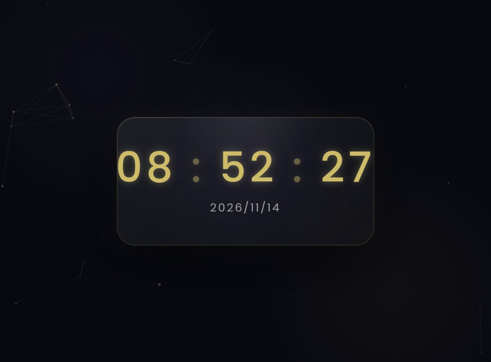

# 🕰️ Royal Digital Clock

<p align="center">
  
</p>

یک ساعت دیجیتال زیبا و مدرن با طراحی شیشه‌ای (Glassmorphism)، پس‌زمینه ذرات شناور و رابط کاربری فارسی (راست‌به‌چپ).

## ✨ ویژگی‌ها

- 🎨 طراحی مدرن با افکت شیشه‌ای و گرادیان تیره
- ❄️ پس‌زمینه ذرات متحرک شناور (Particles.js)
- 🇮🇷 رابط کاربری فارسی با چینش راست‌به‌چپ (RTL)
- 📱 کاملاً واکنش‌گرا (Responsive) — مناسب موبایل و دسکتاپ
- 🔤 فونت Poppins از Google Fonts

## 🌐 مشاهده آنلاین

ساعت به‌صورت زنده از این آدرس قابل بازدید است:

**https://mfcatash.github.io/royal-digital-clock/**

## 🚀 اجرا

هیچ نصب یا وابستگی‌ای لازم نیست! کافیست فایل را باز کنید:

1. پروژه را دانلود یا کلون کنید:
   ```bash
   git clone https://github.com/MFCAtash/royal-digital-clock.git
   ```
2. فایل `index.html` را در مرورگر باز کنید.

## 🛠️ تکنولوژی‌ها

- HTML5
- CSS3 (Glassmorphism، انیمیشن، گرادیان)
- JavaScript
- [Particles.js](https://vincentgarreau.com/particles.js/)
- Google Fonts (Poppins)

## 📁 ساختار پروژه

```
royal-digital-clock/
├── index.html      # فایل اصلی ساعت دیجیتال
├── preview.png     # تصویر پیش‌نمایش
├── LICENSE         # مجوز MIT
└── README.md
```

## 📄 مجوز

این پروژه تحت مجوز [MIT](LICENSE) منتشر شده است.

---

ساخته شده با ❤️ توسط [Mohammad Atash](https://github.com/MFCAtash)
